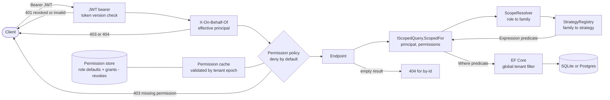
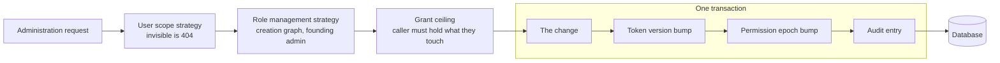

# rbac-role-families

A multi-tenant RBAC and data-scoping library for ASP.NET Core and EF Core, with a demo API.

Every role belongs to a **role family**. The caller's role is read from their token, a resolver picks the scope strategy
registered for the family, and the strategy decides what data the caller may see **by producing the query predicate
itself**. Lists, by-id lookups and narrowed views all apply that same predicate, so they cannot disagree. Anything that
cannot be resolved is denied.

The demo is a booking API: the same `GET /api/v1/bookings` returns different rows for a system admin, internal staff,
an agency admin, agency staff, a corporate user, a finance officer and a customer, and a booking outside the caller's
scope is a 404, not a 403. Around it sits the administration a real multi-tenant product needs: who may create which
roles, grants that cannot escalate, permission edits that survive concurrent editors, an append-only audit trail, acting
on behalf of another user, and a permission cache that stays correct across application instances.

Everything runs and is tested on SQLite with nothing else installed. A Postgres provider and its migrations are in the
repository, but **nothing here has been run against a Postgres server**; see [Known limits](#known-limits).

## Why

Row-level access rules tend to be written twice (a SQL filter for lists, an `if` for single rows) and keyed on the
caller's role in a long `switch`. They drift apart, they depend on registration order, and a role change quietly moves
historical data between users. Administration has its own traps: an admin who can grant anything, a lost update, a log
that can be edited. This repository shows a design that avoids those problems:

- the unit of behaviour is a **role family**, chosen from an explicit registry, never by scanning a list;
- strategies are **pure expressions** that translate to SQL, so one rule serves every read path, for bookings and for users;
- scope is computed from **ownership stamped at write time**, not from the creator's current role;
- permissions are **resolved live**, cached against a persisted per-tenant epoch, and sessions are revoked with a token version;
- callers can only **hand out what they hold**, and every change is one transaction with its audit entry;
- the default is **deny**, and a misconfigured registry or a bad stored role stops the host at startup.

The reasoning is written down in short [architecture decision records](docs/adr).

## Architecture



Administration writes take a different path: the same user scope decides visibility, a management strategy decides what the
caller may do, the grant ceiling checks what they touch, and the change, its session revocation, the epoch move and the audit
entry commit together.



Layers and what they own:

| Project | Responsibility |
| --- | --- |
| `Rbac.Abstractions` | Contracts only: `Principal`, `PrincipalKind`, `RoleFamily`, `RoleDefinition`, `PermissionSet`, `IAccessScopeStrategy<T>`, `IScopeResolver<T>`, `IScopedQuery<T>`, `IPermissionStore`, `ITokenVersionStore`, `ITenantContext`, `IEffectivePrincipalResolver` |
| `Rbac.Core` | `RoleCatalog` and its fluent builder, the booking and user resources, the scope strategies and `NarrowedScope`, `StrategyRegistry` and `ScopeResolver`, the role management strategies and registry (creation graph, founding-admin rule), the grant ceiling and the permission diff rules, `RbacStartupValidator`, the in-memory token version store. No EF Core, no ASP.NET Core |
| `Rbac.AspNetCore` | Claims to `Principal` mapping, `[RequirePermission]` with a dynamic policy provider and handler, deny-by-default fallback policy, token version check for JWT bearer, the `X-On-Behalf-Of` middleware, correlation id, RFC 7807 error handling |
| `Rbac.Persistence` | EF Core model, the tenant global query filter, the live permission store and its epoch-validated cache, persisted token versions, the stored role catalog, user and permission administration, the append-only audit log, `PermissionSeeder`, deterministic demo data, committed Postgres migrations |
| `Rbac.Demo` | The API, the access matrix builder and its markdown renderer, the dev token issuer, health, OpenAPI |

## Roles, families and scopes

| Family | Roles | Booking scope | User scope | What the caller sees |
| --- | --- | --- | --- | --- |
| System | `system-admin` | `SystemScope` | `SystemUserScope` | Every booking and user in their tenant |
| Finance | `finance-officer` | `FinanceScope` | `SelfUserScope` | Refund-related bookings only, unless they hold `reports.view` (then the whole tenant) |
| Internal | `internal-admin`, `internal-staff` | `InternalScope` | `InternalUserScope` | Bookings written by internal staff and guest bookings, never agency- or corporate-owned ones; every user except the system family |
| Corporate | `corporate-admin`, `corporate-staff` | `CorporateScope` | `CorporateUserScope` | Admin: the whole corporate account. Staff: their own bookings unless they hold `bookings.view-all-corporate`. Fails closed without a corporate account |
| Agency | `agency-admin`, `agency-staff` | `AgencyScope` | `AgencyUserScope` | Admin: the whole agency. Staff: their own bookings unless they hold `bookings.view-all-agency`. Fails closed without an agency |
| Viewer | `report-viewer` | `ViewerScope` | `SelfUserScope` | No booking rows |

Customers (`PrincipalKind.Customer`) are not a staff family; they get `CustomerScope` (their own bookings). Anonymous
callers, and tokens with a missing or unknown role, resolve to `NoAccessScope`.

Every strategy also constrains the tenant, and the DbContext adds a global query filter on the same tenant, so a missing
predicate in one layer is still caught by the other.

The complete role by action matrix, with the scope and management strategy of every family, the permission each endpoint
requires and the creation graph, is generated into [`docs/access-matrix.md`](docs/access-matrix.md).

### Who may create whom

Creation is a graph in the role catalog (`CreatableRoleKeys`), enforced by a management strategy per family:

- a caller creates only roles listed for their role; agency and corporate roles are created **inside the caller's own account only**;
- each agency or corporate account has one **founding admin**. Only the founding admin, an internal admin or a system admin
  creates or promotes further admins; other admins create staff only;
- nobody inside an account can delete or demote its founding admin; internal and system admins can, and the next admin created
  for that account becomes the founder;
- system and internal admins act across the accounts of their tenant, and nobody crosses tenants.

## Run it

Nothing to install but the .NET SDK. The demo runs on a local SQLite file with placeholder keys.

```bash
dotnet run --project src/Rbac.Demo -- --environment Development --urls http://localhost:5105
```

That command stays in the foreground, so run these from a second terminal:

```bash
TOKEN=$(curl -s -X POST http://localhost:5105/api/v1/dev/token -H 'Content-Type: application/json' -d '{"userId":"a-agency-staff"}' | sed -E 's/.*"accessToken":"([^"]+)".*/\1/')
curl -s http://localhost:5105/api/v1/bookings -H "Authorization: Bearer $TOKEN"
```

In PowerShell:

```powershell
$token = (Invoke-RestMethod -Method Post -Uri http://localhost:5105/api/v1/dev/token -ContentType application/json -Body '{"userId":"a-agency-staff"}').accessToken
Invoke-RestMethod -Uri http://localhost:5105/api/v1/bookings -Headers @{ Authorization = "Bearer $token" }
```

The API listens on **http://localhost:5105**. On SDK 10, `dotnet run` consumes `--environment` itself, so the application's
arguments go after the `--`. The SQLite file `rbac-demo.db` is created in the project directory (`src/Rbac.Demo`) on first
start and is ignored by git. Stop the server and delete the file to start again from the seed data, and after pulling a change
that alters the schema (SQLite databases are created, not migrated).

[`requests/rbac.http`](requests/rbac.http) is a ready-to-run walkthrough for the VS Code REST Client or the Rider HTTP
client: tokens for each role, the same list as each role, in-scope and out-of-scope lookups, create and cancel, user
management, permission edits with `If-Match`, the audit trail, acting on behalf of another user, and the 401, 403, 404, 409,
412 and 428 cases. It contains one request for every endpoint, and a test checks that stays true. The requests are ordered:
some of them change state (a permission edit revokes that user's sessions), so run the file top to bottom against a fresh
database.

### Seeded users

Tokens are issued for these ids by the dev endpoint (the id is also the user's handle). Tenant `tenant-a` has 17 users,
tenant `tenant-b` has 10, and the seed contains 60 bookings across every status and owner shape (generated deterministically).
Founding admins are marked.

| Role | Tenant A | Tenant B |
| --- | --- | --- |
| `system-admin` | `a-system-admin` | `b-system-admin` |
| `finance-officer` | `a-finance-officer`, `a-finance-reports` (has a `reports.view` grant) | `b-finance-officer` |
| `internal-admin` / `internal-staff` | `a-internal-admin` / `a-internal-staff` | `b-internal-admin` / `b-internal-staff` |
| `corporate-admin` | `a-corporate-admin` (`corp-a1`, founder), `a-corporate-admin-2` (`corp-a1`), `a-corporate2-admin` (`corp-a2`, founder) | `b-corporate-admin` (founder) |
| `corporate-staff` | `a-corporate-staff`, `a-corporate-staff-viewall` (has a `bookings.view-all-corporate` grant) | `b-corporate-staff` |
| `agency-admin` | `a-agency-admin` (`agency-a1`, founder), `a-agency-admin-2` (`agency-a1`), `a-agency2-admin` (`agency-a2`, founder) | `b-agency-admin` (founder) |
| `agency-staff` | `a-agency-staff`, `a-agency-staff-viewall` (has a `bookings.view-all-agency` grant) | `b-agency-staff` |
| `report-viewer` | `a-report-viewer` | `b-report-viewer` |
| customer | `a-customer` | `b-customer` |

### Configuration

| Key | Default | Meaning |
| --- | --- | --- |
| `Demo:EnableDevTokens` | `false` (`true` in Development) | Maps `POST /api/v1/dev/token`. **Demo only**: it issues a token for any seeded user without credentials |
| `Demo:Jwt:SigningKey` | none, required | HS256 key, at least 32 bytes. The Development value is a placeholder |
| `Demo:Jwt:Issuer`, `Demo:Jwt:Audience`, `Demo:Jwt:TokenLifetimeMinutes` | `rbac-demo`, `rbac-demo-api`, `60` | Token validation and lifetime |
| `Persistence:Provider` | `Sqlite` | `Sqlite` or `Postgres` (see Known limits) |
| `Persistence:ConnectionString` | `Data Source=rbac-demo.db` | Connection string for the provider |
| `Persistence:InitializeOnStartup` | `true` | SQLite: create the schema and the audit triggers. Postgres: apply migrations. Then run the permission seeder and load the stored role catalog |
| `Persistence:SeedDemoData` | `false` (`true` in Development) | Write the demo tenants, users and bookings once |
| `Persistence:CachePermissions` | `true` | Cache resolved permissions in process, validated against the tenant's epoch on every request. `false` reads them from the database every time |

Options are validated at startup, so a missing or short signing key stops the host.

## API

All routes are under `/api/v1`. Errors are RFC 7807 `application/problem+json` and never contain stack traces; every
response carries `X-Correlation-Id` (accepted from the caller when it is short and safe, otherwise generated) and
problem documents repeat it as `correlationId`.

| Method and path | Needs | Success | Errors |
| --- | --- | --- | --- |
| `POST /dev/token` | Anonymous; only mapped when `Demo:EnableDevTokens` is true | 200 token | 400, 404 unknown or deleted user |
| `GET /me` | Authenticated | 200 principal, live permissions, and who is acting when on behalf | 401 |
| `GET /bookings?status=&page=&pageSize=&mine=` | `bookings.read` | 200 scoped page | 400, 401, 403 |
| `GET /bookings/{id}` | `bookings.read` | 200 | 401, 403, 404 when out of scope or missing |
| `POST /bookings` | `bookings.create` | 201 draft booking, ownership stamped from the effective caller | 400, 401, 403 |
| `POST /bookings/{id}/cancel` | `bookings.cancel` and in scope | 200 | 401, 403, 404, 409 status does not allow it |
| `POST /users` | `users.create` and the creation graph | 201 | 400, 401, 403, 409 handle taken |
| `GET /users?role=&page=&pageSize=` | `users.read` | 200 users in the caller's scope | 400, 401, 403 |
| `GET /users/{id}` | `users.read` | 200 | 401, 403, 404 when out of scope or missing |
| `PUT /users/{id}/role` | `users.manage` and the management rule | 200, revokes the user's sessions | 400, 401, 403, 404, 409 |
| `DELETE /users/{id}` | `users.manage` and the management rule | 204 soft delete, revokes the user's sessions | 401, 403, 404 |
| `GET /permissions` | `permissions.view` | 200 permission catalog | 401, 403 |
| `GET /roles`, `GET /roles/{key}` | `permissions.view` | 200 roles with the caller's tenant's stored default permissions | 401, 403, 404 |
| `PUT /roles/{key}/permissions` | `roles.manage-permissions` (system admin) and the grant ceiling | 200, applies to the caller's tenant only, revokes that tenant's holders' sessions | 400, 401, 403, 404 |
| `GET /users/{id}/permissions` | `permissions.view`, user in scope | 200 defaults, grants, revokes, effective set, `ETag` | 401, 403, 404 |
| `PUT /users/{id}/permissions` | `users.manage`, user in scope, management rule, grant ceiling, `If-Match` | 200 with the new `ETag`, revokes the user's sessions | 400, 401, 403, 404, 412 stale, 428 missing `If-Match` |
| `GET /audit?target=&actor=&page=&pageSize=` | `audit.view` | 200 entries of the caller's tenant, newest first | 400, 401, 403 |
| `GET /access-matrix` | `access-matrix.view` | 200 role by action matrix from the caller's tenant's stored role defaults | 401, 403 |
| `GET /openapi/v1.json` | Authenticated | 200 OpenAPI 3.1 document | 401 |
| `GET /health/live`, `GET /health/ready` | Anonymous | 200 (readiness checks the database) | 503 when the database is unreachable |

Request headers:

- `X-On-Behalf-Of: <userId>` on any authenticated request: act as another user. Needs `users.act-on-behalf` (403 without it, never
  ignored), a target the caller strictly outranks inside their tenant and account (403 for a peer or a higher role, 404 for a user
  they cannot see, which includes every other tenant), and applies the target's scope and permissions. Audit entries record both ids.
- `If-Match: "<version>"` on `PUT /users/{id}/permissions`, with the version from the last read.
- `X-Client-Channel` (`web`, `app`, `back-office`) is never an authorization input. The list endpoint only echoes a known value back
  as `channelHint`, and a test sends every value for several roles and checks the results and denials do not change.

Precedence of refusals for administration writes: unauthenticated (401), missing permission (403), user not visible (404),
invalid input (400), management rule (403), grant ceiling (403), version precondition (428 or 412).

The OpenAPI document is committed as [`docs/openapi.json`](docs/openapi.json) and a test fails when the generated
document differs from it.

## Tests

```bash
dotnet test                                        # everything: 470 tests, nothing else needs to be installed
dotnet test --project tests/Rbac.Tests             # the unit project only (236)
dotnet test --project tests/Rbac.IntegrationTests  # the API project (234)
```

`global.json` selects Microsoft.Testing.Platform, which xunit.v3 projects need on the .NET 10 SDK, so plain
`dotnet test` works from the repository root. All tests are unit level: SQLite (in memory or a temporary file), in-memory stores,
`WebApplicationFactory` and fake clocks, so no external service is involved.

Many API tests mutate users, permissions or roles, which bumps token versions. Those tests each own their host so a revoked
cached token cannot make a later test fail depending on test order; the matrix rows that run on a shared host are non-mutating.

| Project | What it holds |
| --- | --- |
| `tests/Rbac.Tests` | Strategies against a hand-written dataset, family resolution, startup misconfigurations, the narrowing property, ownership stamping, claims mapping, policy provider and handler, the live permission store, the tenant filter and **every strategy translated to SQL on SQLite with no client-evaluation warnings**, the management rules, the grant ceiling and diff rules (including a randomized property test), the permission cache, the audit trail, the seeder, the on-behalf rules and middleware, the committed access matrix, and a check that the Npgsql model has no pending migration |
| `tests/Rbac.IntegrationTests` | The whole API through `WebApplicationFactory`: the data-driven access matrix and creation matrix replayed over HTTP, list versus by-id for bookings and users, fail-closed cases, tenant isolation, user management, permission administration, the audit trail, acting on behalf, account reuse, two hosts over one database, restarts, ProblemDetails and correlation id, and both generated documents |

The expected results live in [`tests/Rbac.Tests/Matrix/access-matrix.json`](tests/Rbac.Tests/Matrix/access-matrix.json) and
[`creation-matrix.json`](tests/Rbac.Tests/Matrix/creation-matrix.json): for every seeded user, the exact ids each list query
must return and the status of each action, and for every caller role by target role by account relation the status of a user
creation. They are derived from the seed data and the written rules, not from the strategy code, and tests fail if a defined role
has no row.

### What is proven where

Everything below ran as part of `dotnet test` (470 tests) on SQLite. "Two hosts" means two `WebApplicationFactory` instances with
their own caches over one SQLite file.

| Claim | Where it is shown |
| --- | --- |
| One rule for lists and by-id, for bookings and for users | `ListByIdConsistencyTests`, `UsersReadApiTests`, the access matrix over HTTP |
| Strategies translate to SQL, no client evaluation, narrowing only reduces | `ExpressionTranslationTests`, `NarrowedScopeTests` |
| Tenant isolation | `TenantFilterTests` (SQLite), `TenantIsolationApiTests`, user and permission 404s across tenants |
| Role defaults are per tenant: another tenant's edit changes nothing here (permissions, sessions, versions, epoch, audit), and a new tenant gets the catalog defaults | `PermissionAdministrationApiTests`, `PermissionSeederTests`, `RoleCatalogStoreTests`, `PermissionStoreTests`, `TwoInstanceCacheTests`, `AccessMatrixDocumentTests` |
| Deny by default, fail closed, unlisted role on a gated endpoint is 403 | `FailClosedTests`, `AuthenticationTests`, `ScopeResolverTests` |
| Misconfiguration stops the host, including a bad stored role | `RbacStartupValidationTests`, `StartupValidationTests`, `PersistedStateTests` |
| Ownership is stamped at write time; a role change moves nothing historical | `OwnershipStamperTests`, `OwnershipStampPersistenceTests`, `UserManagementApiTests` |
| Live permissions; token versions persist, bump atomically and survive a restart | `LivePermissionTests`, `DbTokenVersionStoreTests` (including 100 concurrent bumps over separate connections), `PersistedStateTests` |
| Creation graph and founding-admin rule | `RoleManagementTests`, `UserCreationMatrixTests`, `UserManagementApiTests` |
| Grant ceiling, diff semantics, lost updates, escalation refused | `PermissionAdministrationRulesTests`, `PermissionAdministrationApiTests` |
| A second instance sees a change on its next request, and only because of the epoch | `CachingPermissionStoreTests`, `TwoInstanceCacheTests` (warm hit, miss after a write, stale without a bump) |
| Audit entries are atomic with the change and cannot be edited or removed | `AuditTrailTests` (interceptor, SQLite triggers, set-based statements), `AuditApiTests` (including a failing audit insert rolling the change back) |
| Acting on behalf: effective rules, refusals, both ids audited | `ActOnBehalfRulesTests`, `OnBehalfMiddlewareTests`, `OnBehalfApiTests` |
| Delete, recreate: a new id that inherits nothing | `AccountReuseApiTests`, `PermissionStoreTests` |
| The seeder is idempotent and respects administrator edits | `PermissionSeederTests`, `PersistedStateTests` |
| `docs/access-matrix.md` and `GET /access-matrix` agree with the code | `AccessMatrixDocumentTests` |
| The OpenAPI document is current and every endpoint has a request in the `.http` file | `OpenApiSnapshotTests`, `RepositoryLayoutTests` |

Not shown by any test here: anything that needs a Postgres server (the committed Postgres migrations' SQL, the Postgres audit
trigger, the seed-record backfill), real separate processes, and the CI workflow on its Linux runner. See Known limits.

### Regenerating the generated files

After changing an endpoint, regenerate the OpenAPI snapshot. After changing a role, a permission, a strategy or an endpoint's
permission, regenerate the access matrix document. Each test fails with the command when its file is out of date.

```bash
UPDATE_OPENAPI_SNAPSHOT=1 dotnet test --project tests/Rbac.IntegrationTests --filter "FullyQualifiedName~OpenApiSnapshotTests"
UPDATE_ACCESS_MATRIX=1 dotnet test --project tests/Rbac.IntegrationTests --filter "FullyQualifiedName~AccessMatrixDocumentTests"
```

```powershell
$env:UPDATE_OPENAPI_SNAPSHOT=1; dotnet test --project tests/Rbac.IntegrationTests --filter "FullyQualifiedName~OpenApiSnapshotTests"
$env:UPDATE_ACCESS_MATRIX=1; dotnet test --project tests/Rbac.IntegrationTests --filter "FullyQualifiedName~AccessMatrixDocumentTests"
```

### Migrations

SQLite uses `EnsureCreated` (plus the audit triggers); the Postgres schema is created by committed EF Core migrations in
`src/Rbac.Persistence/Migrations`, applied at startup when the provider is `Postgres`. After changing the model, add a
migration with the EF tools, for example `dotnet ef migrations add <Name> --project src/Rbac.Persistence`. A test builds the
Npgsql model offline and fails while the model and the migrations disagree; that is the only Postgres check that runs here.

## Design decisions

Short records in [`docs/adr`](docs/adr):

1. [Role families are the unit of strategy selection](docs/adr/0001-role-families-select-the-strategy.md), including why customers are not staff
2. [Strategies emit predicates, so lists and by-id lookups share one rule](docs/adr/0002-strategies-emit-predicates.md)
3. [Deny by default, and fail at startup instead of resolving by order](docs/adr/0003-deny-by-default-and-startup-validation.md)
4. [Ownership is stamped at write time](docs/adr/0004-ownership-is-stamped-at-write-time.md)
5. [Permissions are resolved live, sessions are revoked with token versions](docs/adr/0005-live-permissions-and-token-versions.md)
6. [Out of scope is a 404, a missing permission is a 403](docs/adr/0006-out-of-scope-is-404-not-403.md)
7. [The creation graph and the founding admin](docs/adr/0007-creation-graph-and-founding-admin.md)
8. [Callers can only hand out what they hold](docs/adr/0008-grant-escalation-ceiling.md)
9. [The audit trail is append-only](docs/adr/0009-append-only-audit.md)
10. [Cached permissions are validated against a persisted tenant epoch](docs/adr/0010-epoch-based-cache-invalidation.md)
11. [Acting on behalf applies the effective user's rules](docs/adr/0011-acting-on-behalf-of-another-user.md)

## Known limits

- **Postgres is unverified here.** The `Postgres` provider, the seven committed migrations and the code paths that use
  `INSERT ... ON CONFLICT` upserts are written for Postgres but were not executed against a server in this verification. In
  particular the audit trigger migration (UPDATE, DELETE and TRUNCATE rejection), the migration that backfills role default seed
  records and the migration that gives every existing tenant its own copy of the role defaults (it rewrites a primary key and
  copies rows) are unrun SQL. Treat them as untested until a Postgres run exists.
- **A tenant created while the host runs has no role defaults yet.** Role definitions (key, family, creation graph) are global and
  change only with the code; what a role grants by default is each tenant's own copy, so one tenant's administrator can never touch
  another's. A new tenant gets the catalog's defaults, never another tenant's edits, the next time the seeder runs (every start) or
  at once through `PermissionSeeder.SeedTenantAsync`. Until then its users have no permissions, which is deny by default. There is
  no tenant-creation API in the demo. A catalog version that adds a permission adds it to every tenant's role, and never undoes a
  tenant's removals.
- **The permission cache is in process and needs the epoch.** It costs one single-row read per request. Anything that writes
  permissions outside the application (an operator editing rows) must also bump the tenant's epoch, or warm instances keep serving
  what they hold. There is no external cache server and no push invalidation.
- **The audit trail is not tamper-evident.** Application code cannot change it and the database triggers refuse set-based
  statements, but a database owner can drop the triggers and entries carry no hash chain. Bookings are not audited.
- **Seeding is idempotent but not locked.** Two instances starting at the same instant on an empty database can race on the first
  seed; one fails on a unique constraint and succeeds on restart.
- **Permission edits revoke sessions on purpose.** The edited user (or every holder of an edited role in that tenant) must request a new token.
- The dev token endpoint, the placeholder keys and plain HTTP exist for the demo only. Terminate TLS and use a real identity
  provider anywhere else.
- `.github/workflows/ci.yml` (restore, build with warnings as errors, tests, the two generated-document checks) has not been run
  by a CI runner; nothing here could execute it.
- SQLite is a single-writer database. It is the right size for the demo and the tests and not for load.

## Roadmap

What is really left:

- Policy as data: scope rules and the creation graph expressed in storage instead of strategy classes.
- Invalidation beyond a database epoch: push-based invalidation or a shared cache, for deployments where one read per request matters.
- A tamper-evident audit trail (hash chain or an external append-only sink) and auditing of booking writes.
- A Postgres run in CI with a database service, to turn the unverified items above into tests.
- Per-tenant role structure (families and the creation graph). Today only a role's default permissions are per tenant.

## License

MIT, see [LICENSE](LICENSE).
